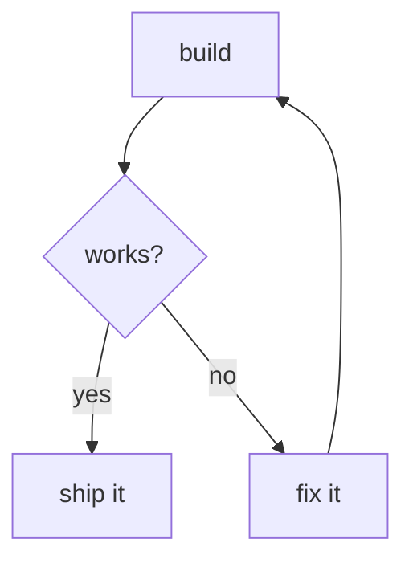
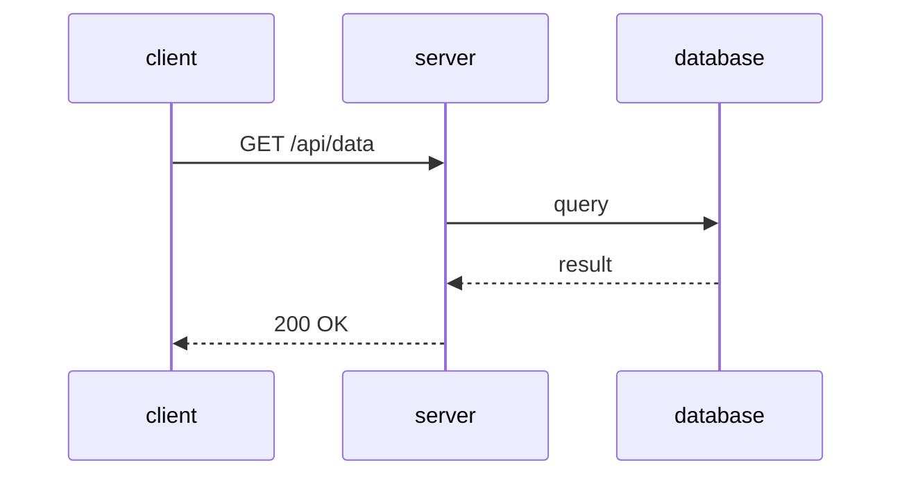
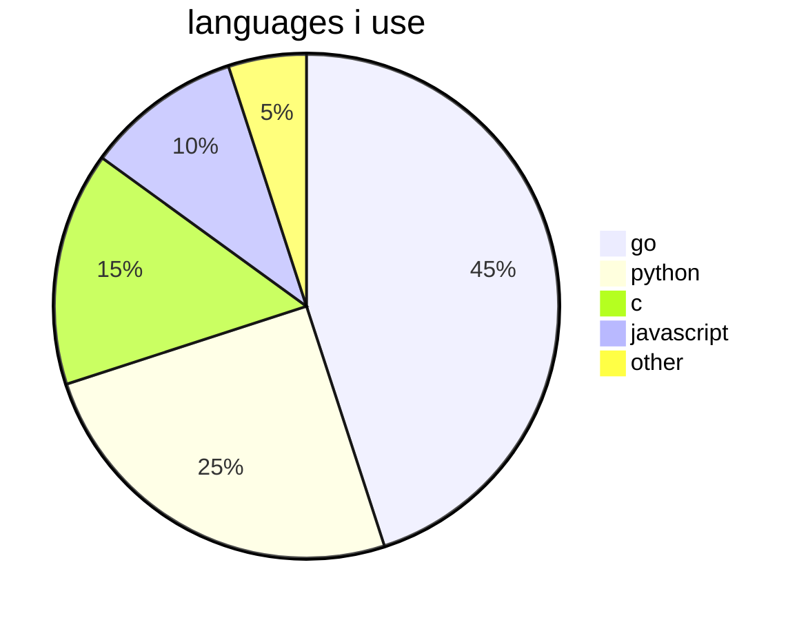
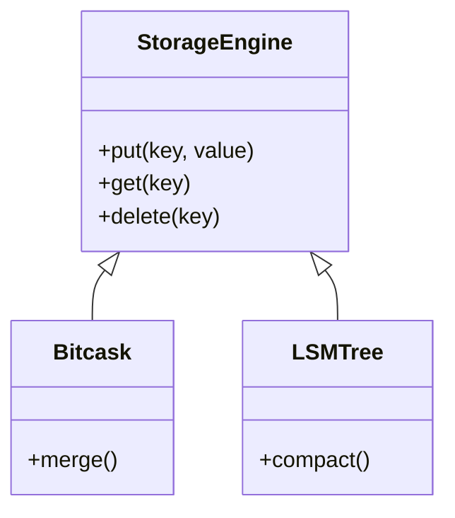
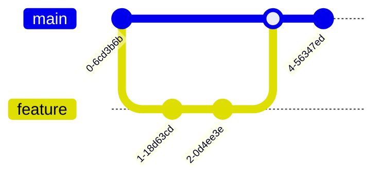
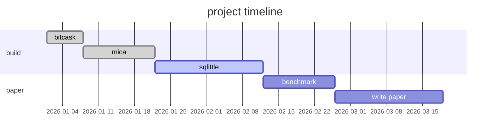
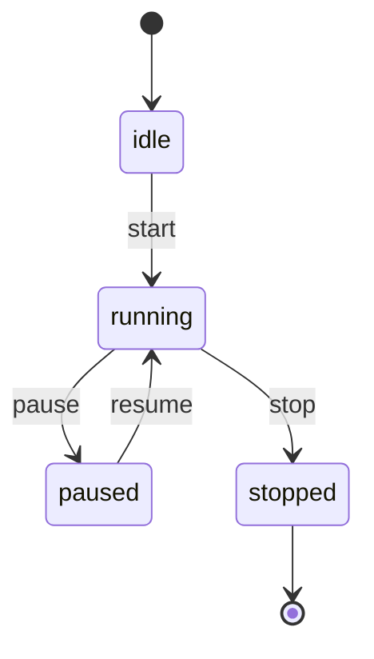
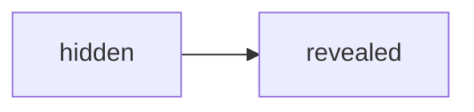

# readme-lab

a playground for exploring everything github markdown can render.

> [!NOTE]
> this readme demonstrates every supported rendering feature on github. each section shows the source syntax followed by its rendered output.
>
> last updated: 2026

---

## headings

```
# h1
## h2
### h3
#### h4
##### h5
###### h6
```

> github auto-generates a table of contents from headings — click the outline icon in the file header.

<a name="custom-anchor"></a>

## custom anchor

you can also use `<a name="unique-name"></a>` to create navigation anchors anywhere, not just on headings.

[jump here](#custom-anchor)

---

## text formatting

| style | syntax | example |
| --- | --- | --- |
| bold | `** **` or `__ __` | **bold text** |
| italic | `* *` or `_ _` | *italic text* |
| bold + italic | `*** ***` | ***all bold and italic*** |
| bold nested italic | `** **` + `_ _` | **bold and *italic*** |
| strikethrough | `~~ ~~` | ~~this was a mistake~~ |
| subscript | `<sub>` | h<sub>2</sub>o |
| superscript | `<sup>` | e = mc<sup>2</sup> |
| underline | `<ins>` | <ins>underlined</ins> |
| highlight | `<mark>` | <mark>highlighted</mark> |
| keyboard | `<kbd>` | press <kbd>cmd</kbd> + <kbd>k</kbd> |
| abbreviation | `<abbr>` | <abbr title="Graphics Interchange Format">gif</abbr> |
| definition | `<dfn>` | <dfn>markdown</dfn> is a lightweight markup language |

---

## blockquotes

```markdown
> single line blockquote
```

> single line blockquote

```markdown
> line 1
> line 2
> line 3
```

> line 1
> line 2
> line 3

```markdown
> level 1
>> level 2
>>> level 3
```

> level 1
>> level 2
>>> level 3

```markdown
> **bold** inside a blockquote
> *italic* inside a blockquote
> `code` inside a blockquote
```

> **bold** inside a blockquote
> *italic* inside a blockquote
> `code` inside a blockquote

---

## alerts (callouts)

```markdown
> [!NOTE]
> useful information users should know.

> [!TIP]
> helpful advice for doing things better.

> [!IMPORTANT]
> key information users need to achieve their goal.

> [!WARNING]
> urgent info that needs immediate attention.

> [!CAUTION]
> advises about risks or negative outcomes.
```

> [!NOTE]
> useful information users should know.

> [!TIP]
> helpful advice for doing things better.

> [!IMPORTANT]
> key information users need to achieve their goal.

> [!WARNING]
> urgent info that needs immediate attention.

> [!CAUTION]
> advises about risks or negative outcomes.

---

## lists

### unordered

```markdown
- item a
- item b
- item c
```

- item a
- item b
- item c

### ordered

```markdown
1. first
2. second
3. third
```

1. first
2. second
3. third

### nested

```markdown
1. parent
   - child a
   - child b
     1. grandchild 1
     2. grandchild 2
2. another parent
```

1. parent
   - child a
   - child b
     1. grandchild 1
     2. grandchild 2
2. another parent

### task lists

```markdown
- [ ] write the readme
- [x] create the repo
- [ ] push to github
- [ ] \(optional) add more features
```

- [ ] write the readme
- [x] create the repo
- [ ] push to github
- [ ] \(optional) add more features

---

## links

### inline link

```markdown
[github](https://github.com)
```

[github](https://github.com)

### reference link

```markdown
[opencode][1]

[1]: https://opencode.ai
```

[opencode][1]

[1]: https://opencode.ai

### relative link

```markdown
[readme](README.md)
```

[readme](README.md)

### section link

```markdown
[go to tables](#tables)
```

[go to tables](#tables)

### footnote link

```markdown
here is a statement with a footnote[^fn1].

[^fn1]: this is the footnote content. it appears at the bottom of the page.
```

here is a statement with a footnote[^fn1].

[^fn1]: this is the footnote content. it appears at the bottom of the page.

### autolink

```
https://github.com/ufraaan/readme-lab
```

https://github.com/ufraaan/readme-lab

---

## images

```markdown

```


### image with link

```markdown
[](https://github.com)
```

[](https://github.com)

### dark/light mode image

```markdown
<picture>
  <source media="(prefers-color-scheme: dark)" srcset="https://github.githubassets.com/assets/GitHub-Mark-ea2971cee799.png">
  <source media="(prefers-color-scheme: light)" srcset="https://github.githubassets.com/assets/GitHub-Mark-ea2971cee799.png">
  
</picture>
```

<picture>
  <source media="(prefers-color-scheme: dark)" srcset="https://github.githubassets.com/assets/GitHub-Mark-ea2971cee799.png">
  <source media="(prefers-color-scheme: light)" srcset="https://github.githubassets.com/assets/GitHub-Mark-ea2971cee799.png">
  
</picture>

---

## tables

### basic table

```markdown
| name  | age | city     |
|-------|-----|----------|
| alice | 30  | mumbai   |
| bob   | 25  | delhi    |
| carol | 35  | bangalore|
```

| name  | age | city     |
|-------|-----|----------|
| alice | 30  | mumbai   |
| bob   | 25  | delhi    |
| carol | 35  | bangalore|

### alignment

```markdown
| left      | center    | right     |
| :---      | :---:     | ---:      |
| git add   | git add   | git add   |
| git commit| git commit| git commit|
```

| left      | center    | right     |
| :---      | :---:     | ---:      |
| git add   | git add   | git add   |
| git commit| git commit| git commit|

### formatted cells

```markdown
| command          | description                         |
|------------------|-------------------------------------|
| `git status`     | list *new or modified* files        |
| `git diff`       | show **unstaged** changes           |
| [git docs](link) | link inside a table                 |
```

| command          | description                         |
|------------------|-------------------------------------|
| `git status`     | list *new or modified* files        |
| `git diff`       | show **unstaged** changes           |
| [git docs](https://git-scm.com/doc) | link inside a table |

### escaped pipe

```markdown
| name     | character |
|----------|-----------|
| pipe     | \|        |
| backtick | `         |
```

| name     | character |
|----------|-----------|
| pipe     | \|        |
| backtick | `         |

### html tables (nested markdown)

```markdown
<table>
<tr>
<th>feature</th>
<th>example</th>
</tr>
<tr>
<td>

- list inside table
- item 2

</td>
<td>

| inner | table |
|-------|-------|
| a     | b     |

</td>
</tr>
</table>
```

<table>
<tr>
<th>feature</th>
<th>example</th>
</tr>
<tr>
<td>

- list inside table
- item 2

</td>
<td>

| inner | table |
|-------|-------|
| a     | b     |

</td>
</tr>
</table>

---

## code

### inline code

```
use `git status` to list changed files.
```

use `git status` to list changed files.

### fenced code block

````
```
function hello() {
    console.log("hello, world!");
}
```
````

```
function hello() {
    console.log("hello, world!");
}
```

### syntax highlighting

````go
package main

import "fmt"

func main() {
    for i := 0; i < 10; i++ {
        fmt.Println(i)
    }
}
````

```go
package main

import "fmt"

func main() {
    for i := 0; i < 10; i++ {
        fmt.Println(i)
    }
}
```

### diff highlighting

```diff
 function old() {
-    console.log("removed");
+    console.log("added");
 }
```

### line highlighting

```go {1,3-4}
package main

import "fmt"

func main() {
    fmt.Println("hello")
}
```

### nested backticks

````
```
triple backticks inside quadruple backticks
```
````

---

## math

### inline math

```
when $a \ne 0$, there are two solutions to $(ax^2 + bx + c = 0)$ and they are $x = {-b \pm \sqrt{b^2-4ac} \over 2a}$.
```

when $a \ne 0$, there are two solutions to $(ax^2 + bx + c = 0)$ and they are $x = {-b \pm \sqrt{b^2-4ac} \over 2a}$.

### block math

```
$$
\frac{n!}{k!(n-k)!} = \binom{n}{k}
$$
```

$$
\frac{n!}{k!(n-k)!} = \binom{n}{k}
$$

### math code block

````math
\oint_C \vec{E} \cdot d\vec{l} = -\frac{d}{dt} \iint_S \vec{B} \cdot d\vec{A}
````

```math
\oint_C \vec{E} \cdot d\vec{l} = -\frac{d}{dt} \iint_S \vec{B} \cdot d\vec{A}
```

---

## mermaid diagrams

### flowchart



### sequence diagram



### pie chart



### class diagram



### git graph



### gantt



### state diagram



---

## geoJSON map

````geojson
{
  "type": "FeatureCollection",
  "features": [
    {
      "type": "Feature",
      "properties": {
        "name": "mumbai"
      },
      "geometry": {
        "type": "Point",
        "coordinates": [72.8777, 19.0760]
      }
    },
    {
      "type": "Feature",
      "properties": {
        "name": "bangalore"
      },
      "geometry": {
        "type": "Point",
        "coordinates": [77.5946, 12.9716]
      }
    },
    {
      "type": "Feature",
      "properties": {
        "name": "delhi"
      },
      "geometry": {
        "type": "Point",
        "coordinates": [77.1025, 28.7041]
      }
    }
  ]
}
````

---

## STL 3D model

````stl
solid cube
  facet normal 0.0 -1.0 0.0
    outer loop
      vertex 0.0 0.0 0.0
      vertex 1.0 0.0 0.0
      vertex 0.0 0.0 1.0
    endloop
  endfacet
  facet normal 0.0 0.0 -1.0
    outer loop
      vertex 0.0 0.0 0.0
      vertex 0.0 1.0 0.0
      vertex 1.0 0.0 0.0
    endloop
  endfacet
  facet normal -1.0 0.0 0.0
    outer loop
      vertex 0.0 0.0 0.0
      vertex 0.0 0.0 1.0
      vertex 0.0 1.0 0.0
    endloop
  endfacet
  facet normal 0.577 0.577 0.577
    outer loop
      vertex 1.0 0.0 0.0
      vertex 0.0 1.0 0.0
      vertex 0.0 0.0 1.0
    endloop
  endfacet
endsolid
````

---

## color models

```
`#0969DA` `rgb(9, 105, 218)` `hsl(212, 92%, 45%)`
```

`#0969DA` `rgb(9, 105, 218)` `hsl(212, 92%, 45%)`

> color swatches only render in issues, pull requests, and discussions — not in readme files.

---

## collapsed sections

```markdown
<details>
<summary>click to reveal</summary>

this content is hidden by default.

- you can put **markdown** inside
- `code` works too
- even mermaid:



</details>
```

<details>
<summary>click to reveal</summary>

this content is hidden by default.

- you can put **markdown** inside
- `code` works too
- even mermaid:


</details>

<details open>
<summary>this section starts open</summary>

add `open` attribute to `<details>` to make it start expanded.

</details>

---

## mentions and references

### user mention

```
@ufraaan
```

@ufraaan

### issue/PR reference

```
#1
```

#1

### cross-repo reference

```
ufraaan/projects-to-do#1
```

### commit SHA

```
a5c3785ed8d6a35868bc169f07e40e889087fd2e
```

a5c3785ed8d6a35868bc169f07e40e889087fd2e

### label reference

```
https://github.com/ufraaan/readme-lab/labels/enhancement
```

https://github.com/ufraaan/readme-lab/labels/enhancement

---

## emoji

```
:rocket: :fire: :+1: :shipit: :tada: :100: :zzz: :octocat:
```

:rocket: :fire: :+1: :shipit: :tada: :100: :zzz: :octocat:

---

## horizontal rules

```markdown
---
```

---

```markdown
***
```

***

```markdown
___
```

___

---

## line breaks

```markdown
two spaces at end of line →  
new line starts here

backslash at end of line →\
new line starts here

<br/> html tag works too
<br/>
```

two spaces at end of line →  
new line starts here

backslash at end of line →\
new line starts here

<br/> html tag works too
<br/>

---

## escaping

```
\*not italic\* \_not underlined\_
\# not a heading
\[not a link\]
```

\*not italic\* \_not underlined\_
\# not a heading
\[not a link\]

---

## html inside markdown

### definition list

```html
<dl>
  <dt>http</dt>
  <dd>hypertext transfer protocol</dd>
  <dt>tcp</dt>
  <dd>transmission control protocol</dd>
</dl>
```

<dl>
  <dt>http</dt>
  <dd>hypertext transfer protocol</dd>
  <dt>tcp</dt>
  <dd>transmission control protocol</dd>
</dl>

### div container

```html
<div align="center">
  <p><strong>centered text block</strong></p>
  <p><em>using an html div</em></p>
</div>
```

<div align="center">
  <p><strong>centered text block</strong></p>
  <p><em>using an html div</em></p>
</div>

### details inside table

```html
<table>
<tr>
<td>

<details>
<summary>click for info</summary>

- hidden content
- inside a table cell

</details>

</td>
</tr>
</table>
```

<table>
<tr>
<td>

<details>
<summary>click for info</summary>

- hidden content
- inside a table cell

</details>

</td>
</tr>
</table>

---

## comments (hidden content)

```markdown
<!-- this text will not appear in rendered output -->
```

<!-- this text will not appear in rendered output -->

---

## footnotes

here is some text[^2].

[^2]: this footnote appears at the bottom. it can contain **formatting** and `code`.

a footnote can also have multiple lines[^3].

[^3]: first line
    second line (indent 4 spaces)


---

## reference-style links

```markdown
i use [opencode] for my tools and [gh] for hosting.

[opencode]: https://opencode.ai
[gh]: https://github.com
```

---

## numbered reference links

```markdown
this is [an example][1] reference-style link.

[1]: https://example.com
```

---

## everything at a glance

| category | features |
|----------|----------|
| typography | bold, italic, strikethrough, subscript, superscript, underline, highlight, keyboard, abbreviation, definition |
| structure | headings (h1-h6), blockquotes, alerts, horizontal rules, paragraphs, line breaks |
| lists | unordered, ordered, nested, task lists |
| links | inline, reference, relative, section, footnote, autolink, mention, issue ref, commit sha |
| media | images, picture element (dark/light mode), geoJSON maps, STL 3d models |
| code | inline, fenced, syntax highlighting, diff, line highlighting |
| math | inline ($), block ($$), math code block |
| diagrams | mermaid (flowchart, sequence, pie, class, git, gantt, state) |
| tables | pipe tables, html tables, alignment, nested formatting, nested markdown |
| interactive | collapsed sections, html comments, custom anchors |
| html | div, details, summary, table, kbd, sup, sub, ins, mark, abbr, dfn, dl, picture |
| emoji | shortcodes (:rocket:) |
| colors | hex, rgb, hsl swatches (issues/prs only) |
| special | escapes, footnotes, reference links, task lists |

---

> [!TIP]
> view the raw source of this file to see the markdown syntax for each feature.
